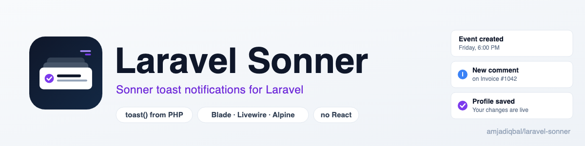
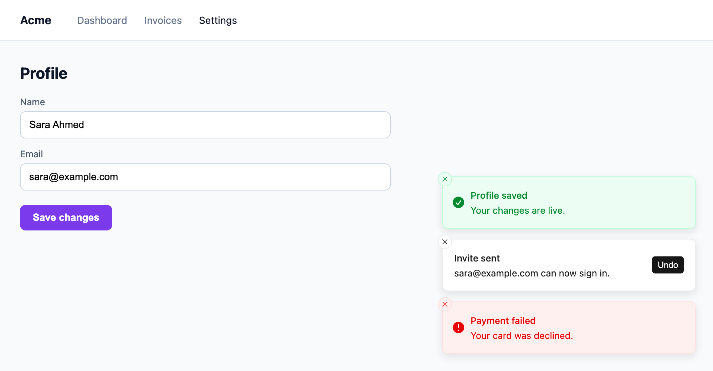

<p align="center">
  <picture>
    <source media="(prefers-color-scheme: dark)" srcset="art/banner-dark.png">
    
  </picture>
</p>

# Laravel Sonner: Sonner toast notifications for Laravel

[Sonner](https://sonner.emilkowal.ski) toast notifications for Laravel, without React. Flash a toast from a
controller with `toast()->success('Saved')`, put `<x-sonner />` in your layout, and it shows up with Sonner's
own stacking, animations, swipe-to-dismiss and themes. Toasts from Livewire actions appear without a reload.
No npm install, no build step.

[](https://packagist.org/packages/amjadiqbal/laravel-sonner)
[](https://packagist.org/packages/amjadiqbal/laravel-sonner)
[](LICENSE.md)

<p align="center">
  
</p>

```php
// In a controller
toast()->success('Profile saved')->description('Your changes are live.');

return back();
```

```blade
{{-- Once, in your layout, before </body> --}}
<x-sonner />
```

## Why this package

Sonner is the toast library behind shadcn/ui and much of the React world, but it is a React component, so a
Blade or Livewire app can't use it directly. This package brings it over:

- **The real Sonner look.** Sonner 2.0.8's `styles.css` is bundled unchanged, and a small runtime ports
  Sonner's Toaster logic to plain JavaScript: the same markup, data attributes and timings. Rendered side by
  side in headless Chrome, its screenshots are identical to React Sonner's.
- **Toasts from PHP.** `toast()` flashes to the session and survives the redirect. Each toast shows once.
- **Livewire without wiring.** Call `toast()` in a Livewire action and it appears in the same response. If
  the action redirects (with or without `wire:navigate`), it waits for the next page.
- **The JavaScript API you know.** `toast()`, `toast.success()`, `toast.promise()`, `toast.loading()` and
  `toast.dismiss()` work in the browser as they do in Sonner.
- **Safe output.** Toast text is always rendered as text, the queue is JSON with `<`, `>` and `&` escaped,
  and the inline style and script carry Laravel's CSP nonce when you use one.

## Requirements

- PHP 8.3+
- Laravel 12 or 13
- Optional: Livewire 3.6+ or 4 (tested with 3.8.10 and 4.4.7) and Alpine.js

## Installation

```bash
composer require amjadiqbal/laravel-sonner
```

Add the toaster to your layout, once, just before `</body>`:

```blade
<x-sonner />
```

That's it. The first `<x-sonner />` on a page prints the styles and the runtime inline (about 11 KB
gzipped), so there is nothing to publish or bundle.

## Usage

### From PHP

```php
toast('Event has been created');                       // a plain toast

toast()->success('Profile saved');
toast()->info('New version available');
toast()->warning('Your trial ends in 3 days');
toast()->error('Payment failed')->description('Your card was declined.');
```

Every option Sonner has for a single toast:

```php
toast()->success('Invite sent')
    ->description('sara@example.com can now sign in.')
    ->action('View', route('team.index'))   // button that closes the toast, then opens the URL
    ->cancel('Dismiss')                      // secondary button that just closes it
    ->duration(8000)                         // milliseconds (default 4000)
    ->persistent()                           // or: stay until closed
    ->position('top-center')                 // top-left, top-center, top-right, bottom-left, bottom-center, bottom-right
    ->closeButton()
    ->richColors()
    ->invert()
    ->dismissible(false)                     // no swipe or close
    ->className('my-toast')
    ->id('invite');                          // toasts with the same id replace each other
```

The `Sonner` facade does the same, if another package in your app already defines `toast()`:

```php
use AmjadIqbal\Sonner\Facades\Sonner;

Sonner::success('Saved');
```

### The toaster

`<x-sonner />` takes Sonner's `<Toaster />` props as attributes:

```blade
<x-sonner
    position="top-center"
    theme="system"
    rich-colors
    expand
    close-button
    :duration="5000"
    :visible-toasts="5"
    :gap="14"
    offset="32px"
    dir="rtl"
/>
```

`theme` is `light` (the default, as in Sonner), `dark` or `system`; `expand` shows every toast instead of a
stack. Defaults for all of these live in `config/sonner.php`:

```bash
php artisan vendor:publish --tag=sonner-config
```

### From JavaScript

The runtime defines `window.toast` (unless something else already did) and always `window.Sonner`, with
Sonner's API:

```js
toast('Event has been created', {
  description: 'Monday, January 3rd at 6:00pm',
  action: { label: 'Undo', onClick: () => undo() },
});

toast.success('Saved');
toast.error('Something went wrong');

const id = toast.loading('Uploading...');
toast.success('Uploaded', { id });          // same id: the loading toast turns into a success toast

toast.promise(fetch('/api/report'), {
  loading: 'Building your report...',
  success: (response) => 'Report ready',
  error: 'Could not build the report',      // a response with ok === false counts as an error, as in Sonner
});

toast.dismiss(id);                          // or toast.dismiss() for all
```

Toast text is always set as text, never HTML, so `title` and `description` are strings. Custom JSX toasts
(`toast.custom()`) are React-only and not available.

### Livewire

Nothing to add. Call `toast()` in an action:

```php
public function save(): void
{
    $this->user->update($this->form->all());

    toast()->success('Profile saved');
}
```

The toast appears as soon as the request finishes. When the action redirects, including
`$this->redirect(..., navigate: true)`, the toast is kept for the next page instead. Toasts that are open
when you follow a `wire:navigate` link stay on screen.

To turn this off, set `'livewire' => false` in `config/sonner.php`.

### Alpine and browser events

Dispatch a `sonner:toast` event with the toast's options:

```blade
<button x-data @click="$dispatch('sonner:toast', { message: 'Copied!', type: 'success' })">Copy</button>
```

From a Livewire component, `$this->dispatch('sonner:toast', message: 'Copied!', type: 'success')` does the
same.

### Keyboard and accessibility

As in Sonner, the toasts live in an `aria-live="polite"` region, `Alt+T` expands and focuses them, and
`Escape` collapses them again. Change the hotkey with `:hotkey="['altKey', 'KeyN']"` or in the config.

## Configuration

```php
// config/sonner.php
return [
    'toaster' => [
        'position' => 'bottom-right',
        'theme' => 'light',
        'rich_colors' => false,
        'expand' => false,
        'close_button' => false,
        'duration' => 4000,
        'visible_toasts' => 3,
        'gap' => 14,
        'offset' => null,          // 24px on desktop
        'mobile_offset' => null,   // 16px under 600px wide
        'dir' => 'auto',
        'invert' => false,
        'hotkey' => ['altKey', 'KeyT'],
        // aria labels ...
    ],
    'global' => true,     // define window.toast
    'livewire' => true,   // deliver toasts from Livewire actions in the same response
];
```

To change the markup the component prints, publish the view with
`php artisan vendor:publish --tag=sonner-views`.

### One difference from Sonner

In the dark theme with rich colors, Sonner fills error toasts with a very dark red and warning toasts with a
very dark olive. Here those two get a neutral near-black background with a red or yellow border and text.
Everything else is Sonner's stylesheet as published. Set `--error-bg` and `--warning-bg` on
`[data-sonner-toaster]` in your own CSS if you want Sonner's originals back.

## Upgrading from the dev-main version

The earlier, unreleased code drew its own toasts rather than Sonner's and had a
`AmjadIqbal\Sonner\Livewire\UsesSonner` trait. The trait is gone because Livewire now works without it,
and the PHP builder no longer has `promise()`, which could not work from PHP: use `toast.promise()` in
JavaScript. `toast()`, `->success()`, `->description()`, `->duration()`, `->position()`,
`->dismissible()` and `<x-sonner />` work as before. See the [changelog](CHANGELOG.md).

## Testing

```bash
composer test
scripts/ci-local.sh   # every PHP 8.3–8.5 × Laravel 12/13 combination, Pint and PHPStan
```

## Need this built into your app, or something custom?

I build Laravel packages, Livewire features and admin panels for teams. If you'd rather have
notifications, or anything else, designed and wired into your app for you,
[get in touch](https://amjad.com.pk/contact?utm_source=github&utm_medium=readme&utm_campaign=laravel-sonner).

## Support

- 🐛 **Bug or feature request**: [open an issue](https://github.com/amjadiqbal/laravel-sonner/issues)
- 🔒 **Security issue**: please report privately via GitHub's security tab

## Need this customised, or something built?

I'm available for custom development, package integration, and technical consulting.

[](https://www.upwork.com/freelancers/amjadkhatri)

## More packages

Part of a family of open-source packages. See [all of them](https://github.com/amjadiqbal?tab=repositories).

| | |
|---|---|
| [laravel-driver-js](https://github.com/amjadiqbal/laravel-driver-js) | Driver.js product tours and onboarding for Laravel |
| [laravel-rough-notation](https://github.com/amjadiqbal/laravel-rough-notation) | Hand-drawn highlights and annotations for Blade |
| [laravel-tiptap](https://github.com/amjadiqbal/laravel-tiptap) | Tiptap editor for Laravel |
| [kiln](https://github.com/amjadiqbal/kiln) | Deploy-time OPcache control for Laravel |

## Credits

- [Sonner](https://github.com/emilkowalski/sonner) by Emil Kowalski (MIT). Its stylesheet is bundled
  unchanged and the runtime is a port of its source. This package is an independent wrapper and is not
  affiliated with Sonner.
- [Amjad Iqbal](https://amjad.com.pk)

## License

MIT. See [LICENSE.md](LICENSE.md). The bundled Sonner stylesheet and the ported runtime keep Sonner's MIT
notice.
